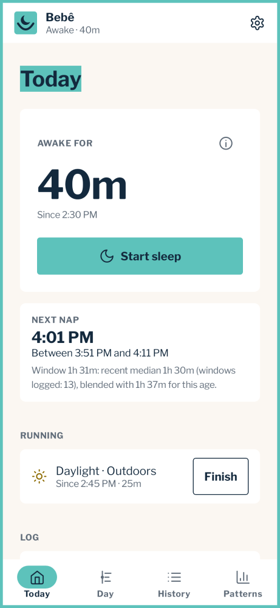
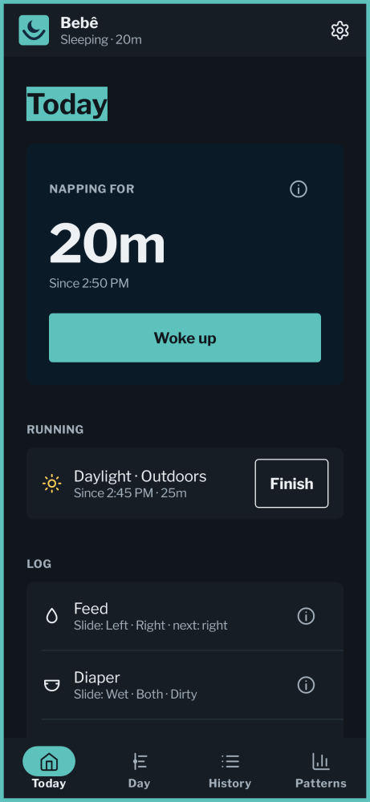
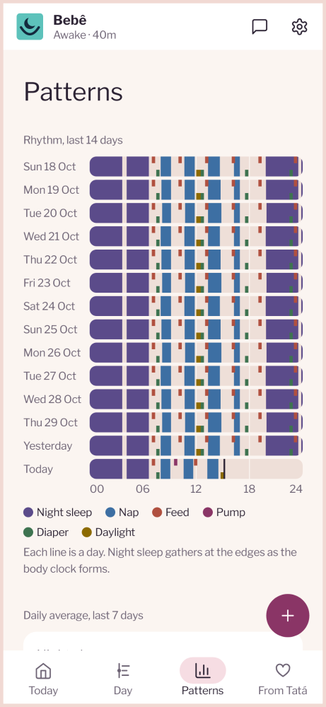
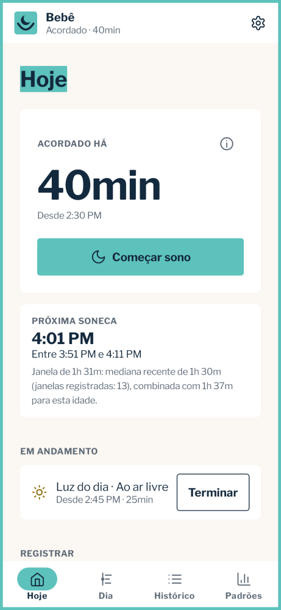

# Cochilo

A personal Android app for tracking a baby's sleep: one tap to start and stop a sleep, logs for
feeds, pumping, diapers, daylight, routines and notes, and a prediction of the next nap or bedtime
learned from the baby's own history. Everything stays on the phone; backups are files you export
and import yourself.

**Cochilo, da Tatá Slings**: a [Tatá Slings](https://tataslings.com.br) product. Built on the
[Gabriel Design System](https://github.com/gabrielbr/Gabriel-Deisgn-System) (`cochilo` layer),
dressed in the Tatá Slings brand (teal, navy, Pérola, Libre Franklin, the moon-in-a-sling mark;
[docs/tata-slings/](docs/tata-slings/README.md)). The research behind it is in
[docs/research.md](docs/research.md). What changed in each release: [CHANGELOG.md](CHANGELOG.md).

| Today | Asleep (dark) | Patterns | Hoje (pt-BR) |
|---|---|---|---|
|  |  |  |  |

## What it does

- **Today**: awake/asleep timer with one action (Start sleep / Woke up), the next nap or bedtime
  with its window and the reason for it, running timers (a feed, a walk outside), quick log
  buttons, a 24-hour timeline and the day's entries. Tap any entry to edit or delete it.
- **Day**: one day two ways. A 24-hour ring (midnight at the top; sleep on the outer ring, feeds,
  pumping and daylight inside, dots for diapers) with the total sleep in the middle, then every
  entry hour by hour on a vertical rail: sleeps as bars as long as they lasted, and the awake time
  between them. Arrows move between days; tap an entry to edit it.
- **History**: every day with its summary, timeline and entries.
- **Icons**: every kind of entry has its line icon (a drop, a bottle, a spoon, a pump, a diaper,
  the moon, the sun, a bath, a capsule, a pencil), always beside its name (`ui/kit/Icons.kt`).
- **Medicine**: its own entry type and log row; the name and dose go in the note.
- **Slide to log**: on Today's log rows, slide instead of tapping. Feed: left = left breast, right =
  right breast. Diaper: Wet · Both · Dirty. Slide a running breastfeed to switch side. Tap still
  opens the full sheet. How many taps each entry costs, and why: [docs/flows.md](docs/flows.md).
- **Notifications**: a quiet live notification, asleep or awake, with a running clock, the expected
  wake or next nap, a timeline bar and Woke up / Start sleep; running timers get Finish (and Switch
  side). [docs/notifications.md](docs/notifications.md).
- **"i" buttons**: each kind of entry (on the log rows, the sleep panel and each entry's sheet) has
  an "i" that explains what it's for, in English and Portuguese.
- **Patterns**: a 14-day actogram (the day/night rhythm forming) and 7-day averages next to the
  reference range for the baby's age.
- **Settings**: baby's name, birth date and due date (for corrected age), theme, language
  (English or Português, from the phone's per-app language setting), export and import.

### How the prediction works

Phase 1 of [docs/research.md §7.2](docs/research.md): for each wake window of the day (first after
the morning wake, second, … and the one before bed) it takes the recency-weighted median of the
baby's own windows over the last 14 days and blends it with an age-based prior,
`(n·personal + 5·prior) / (n + 5)`. The prior fades after about a week of logging. Bedtime is the
weighted median of recent bedtimes; when the next nap would land within 45 minutes of it, the app
shows bedtime instead. The card always says which numbers it used. Code:
[`domain/Predictor.kt`](app/src/main/java/br/gabriel/cochilo/domain/Predictor.kt).

### Your data

- No account, no cloud backup (Android's auto backup is off), no analytics.
- Two builds ([docs/distribution.md](docs/distribution.md)): the **family build** from GitHub
  releases updates itself, so it may reach GitHub to ask for a newer version and download it, and
  nothing else; the **Play build** has no internet permission at all.
- **Export backup** writes everything (baby + every entry) as JSON. **Import backup** merges a
  file: new entries are added, an entry you edited more recently replaces the older copy, and
  nothing is ever deleted, so importing the same file twice changes nothing.
- **Export spreadsheet** writes a CSV for Sheets or Excel (export only).
- **Import from Napper** reads Napper's logs export (the `…-logs-….csv` file): naps, nights (each
  bedtime to the next wake-up, split around night wakings), feeds, bottles, diapers and medicine
  notes. Like a backup import it never deletes, and importing the same file twice adds nothing.
  Napper's measurements file isn't read (Cochilo doesn't track growth).

## Build

Needs JDK 17+ and the Android SDK (platform 35).

```sh
./gradlew :app:testGithubDebugUnitTest :app:testPlayDebugUnitTest   # unit tests + screenshot checks
./gradlew :app:recordPaparazziGithubDebug                            # re-record screenshots after a UI change
./gradlew :app:assembleGithubDebug    # app/build/outputs/apk/github/debug/app-github-debug.apk
./gradlew :app:assemblePlayDebug      # the Play build, no internet permission
```

The debug build installs as `br.gabriel.cochilo.debug`, beside a release build.

## Layout

| Path | What |
|---|---|
| `app/src/main/java/br/gabriel/cochilo/data` | Room database: one `events` table, the `baby` row, small prefs |
| `.../domain` | Pure Kotlin: `Predictor`, `Stats`, age `Reference`, sleep maths |
| `.../backup` | JSON backup format, merge, CSV |
| `.../ui/theme` | `CTokens.kt` (generated by the design system, copied as is) and `CochiloTheme` |
| `.../ui/kit` | The design system's components in Compose: frame, header, tab bar, rows, buttons, chips, fields, timeline, actogram, pickers |
| `.../ui/screens` | Today, History, Patterns, Settings, sheets |
| `app/src/test` | Predictor, stats and backup tests; Paparazzi screenshots of every screen |
| `design-system/` | The design-system change (the `cochilo` layer and the Tatá Slings brand), waiting to be merged there |

Rules for working here: [AGENTS.md](AGENTS.md). Plans for Cochilo as a Tatá Slings product
(monetization, voice, design system, marketing): [docs/tata-slings](docs/tata-slings/README.md).
